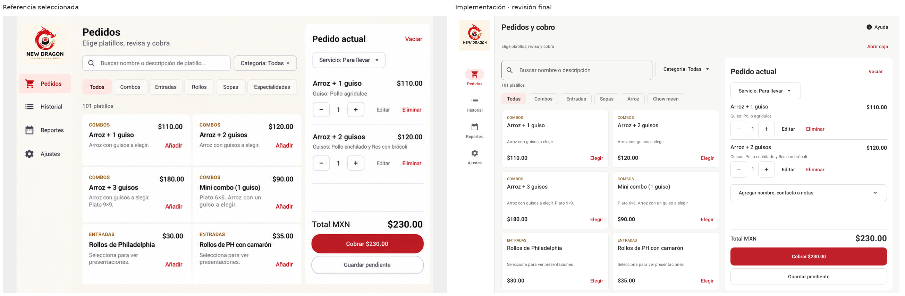
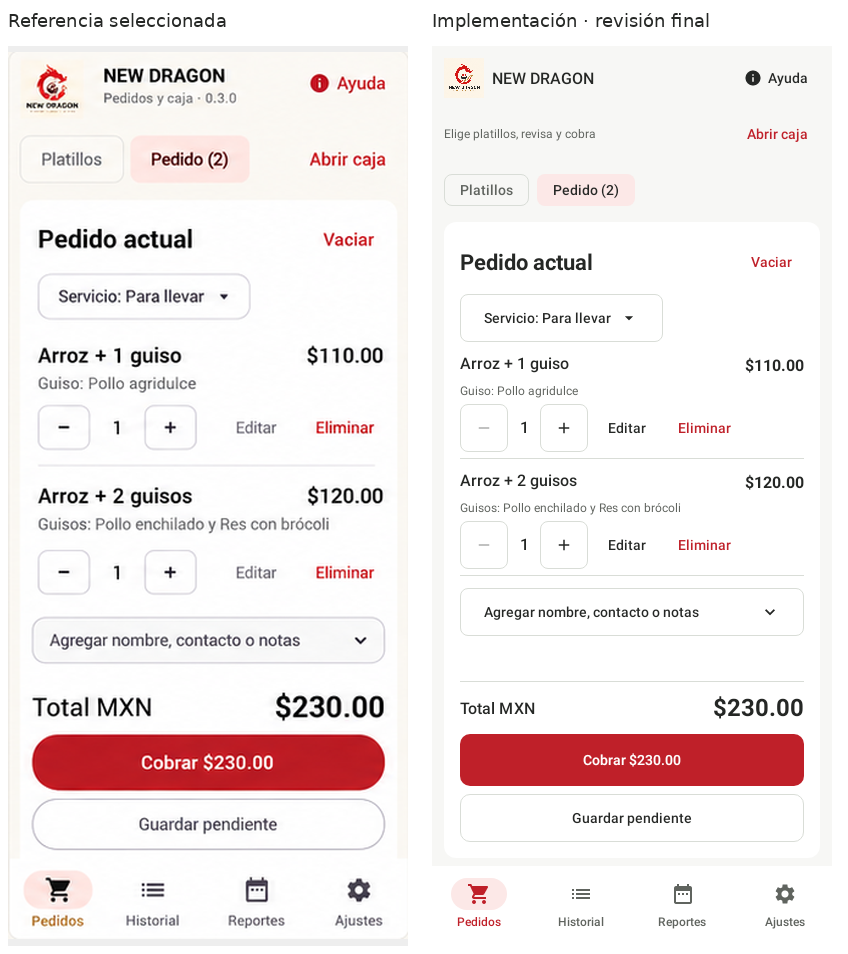
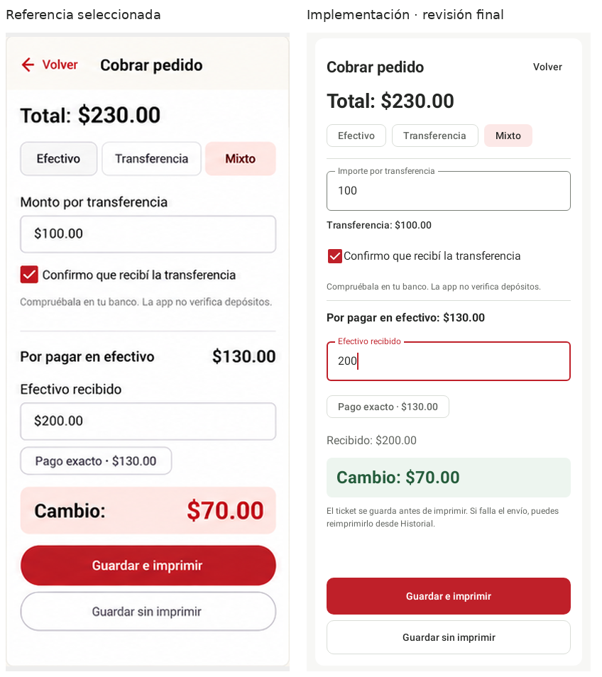
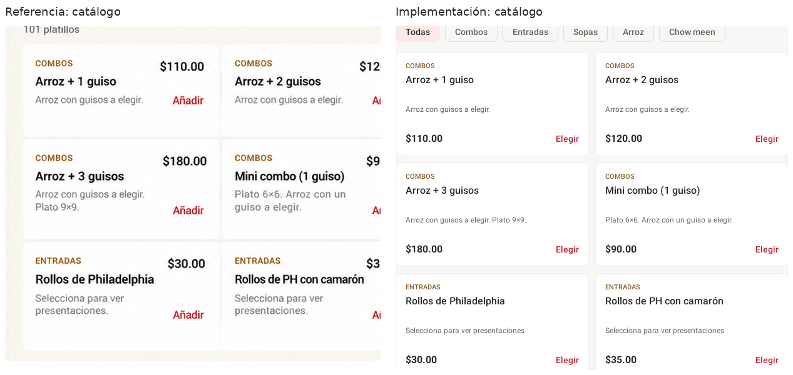

# Design QA · New Dragon 0.3.1 · Operación ágil

final result: passed

## Alcance y criterio

La persona usuaria eligió explícitamente la opción 2 mediante su descripción en texto, después de que Chrome no mostrara las imágenes. Se implementó esa dirección en la aplicación Android existente, con Kotlin y Jetpack Compose. No es un prototipo web ni una certificación de correspondencia píxel a píxel con una imagen generada.

Los criterios son la navegación lateral en tablet, catálogo compacto de dos columnas, pedido simultáneo con total/cobro accesibles, navegación inferior en teléfono y un cobro legible que distinga total, transferencia, efectivo recibido y cambio. Se conservan las funciones y reglas existentes.

## Referencia y evidencia

- Fuente visual: [docs/design-qa/reference-operation-agil.png](docs/design-qa/reference-operation-agil.png), copia del resultado elegido del último conjunto de propuestas.
- La imagen completa mide 1839 × 855 px y contiene tres superficies. Se aislaron los marcos de tablet y teléfono sin inventar contenido.
- Implementación: capturas de la aplicación real mediante las pruebas existentes y nuevas de Compose, renderizado nativo de Robolectric, Android API 34, densidad mdpi (1 px/dp), tema claro.
- Tablet: 1280 × 800 dp/px. Teléfono: 400 × 900 dp/px. También se comprobaron 320 × 640 dp/px y texto al 200 %.
- Las comparaciones incluyen el mismo pedido: $110 + $120 = $230; pago mixto de $100 por transferencia, $200 recibidos en efectivo, $70 de cambio.
- La captura de cobro conserva el foco en el campo de efectivo. El borde rojo indica foco del tema de marca, no un error de validación.
- No corresponde ejecutar un navegador ni comprobar consola JavaScript: la superficie es nativa Android. No se han sustituido capturas de una web por comprobaciones HTTP.

### Normalización

El arte generado rotula sus marcos como 1280 × 800 y 400 × 900, pero sus píxeles dibujados no tienen exactamente esas dimensiones ni proporciones. Se preservó la proporción de cada recorte y se normalizó con margen gris, sin estirar texto ni componentes:

| Superficie | Recorte de referencia | Tamaño ajustado | Captura Android |
| --- | --- | --- | --- |
| Pedidos en tablet | 1091 × 727 px | 1201 × 800 px | 1280 × 800 px |
| Pedido en teléfono | 328 × 727 px | 400 × 887 px | 400 × 900 px |
| Cobro en teléfono | 328 × 727 px | 400 × 887 px | 400 × 900 px |

No se interpretan como defectos las diferencias causadas por los marcos aproximados del arte generado. La app conserva los componentes nativos, el logo original y los datos reales del catálogo.

### Comparaciones inspeccionadas

Cada archivo muestra referencia e implementación juntas, con etiquetas. Se abrió cada comparación antes de emitir este resultado.

Capturas adicionales: [tablet en cobro](previews/0.3.1/operation-tablet-payment.png), [ventana pequeña](previews/0.3.1/operation-small-payment.png), [pedido con letra ampliada](previews/0.3.1/operation-large-text-order.png) y [cobro con letra ampliada](previews/0.3.1/operation-large-text-payment.png).

## Historial de correcciones

| Hallazgo | Impacto | Corrección | Evidencia posterior |
| --- | --- | --- | --- |
| P1: un aviso inferior podía interceptar el botón Guardar al retomar un pendiente. | Impedía completar el cobro con un toque mientras el aviso estaba presente. | Se trasladó el host de avisos a la parte superior, sin desplazar el formulario. | DeliveryInterfaceTest volvió a aprobar el recorrido completo; 60 pruebas finales aprobadas. La captura del ticket muestra el aviso en la cabecera. |
| P2: búsqueda y categoría ocupaban filas separadas en tablet y dejaban parte de la tercera fila del catálogo fuera del primer vistazo. | Reducía la densidad útil respecto a la dirección elegida. | Filtros en una misma fila cuando hay al menos 540 dp disponibles; disposición vertical en teléfono. | comparison-tablet-order.png muestra seis tarjetas completas y sus precios. |
| P2: cabeceras y acciones fijas no eran adecuadas para ventanas cortas o letra muy ampliada. | Riesgo de dejar campos o acciones fuera de alcance. | El pedido completo pasa a ser desplazable en esa situación; el resumen de cobro también pasa a la zona desplazable. | OperationInterfaceTest valida 320 × 640 y texto al 200 %, desplazamiento hasta cobro, pago exacto y acciones finales. |

La comparación anterior a compactar filtros se conserva en [comparison-initial-tablet-order.png](docs/design-qa/comparison-initial-tablet-order.png).

Las pruebas se actualizaron para localizar selectores mediante texto y acción, en lugar de depender del antiguo carácter de flecha. La prueba del guiso conserva las comprobaciones de edición, nota, eliminación y deshacer. Las comprobaciones de dinero y almacenamiento no se debilitaron.

## Superficies de fidelidad revisadas

| Superficie | Resultado |
| --- | --- |
| Tipografía | Sans de Android/Roboto, escala común, títulos y cantidades destacados, ayuda en menor tamaño. Nombres largos pueden ocupar dos líneas. Las etiquetas de campos permanecen identificables. |
| Espaciado y disposición | Rail en tablet, dos columnas de catálogo y panel de pedido; navegación inferior en teléfono. Márgenes y controles nativos consistentes. Las acciones se fijan en tamaños habituales y pasan al desplazamiento cuando es necesario para accesibilidad. |
| Colores y estados | Rojo de marca para prioridad y selección, texto oscuro, superficies blancas/gris cálido, diálogos sin lavanda. Cambio en verde con etiqueta explícita: una adaptación intencional para no sugerir un error con rojo. |
| Imágenes e iconos | Se reutiliza el logo suministrado, no una recreación generada. Iconos de Material; el signo de reducir usa el vector oficial de Google con licencia y procedencia en third_party/material-icons. Sin fotos de comida inventadas. |
| Contenido | Importes coherentes, cuatro destinos conocidos y conservación de guardar con/sin impresión. Se usa «Elegir» en el catálogo porque seleccionar un platillo puede requerir presentaciones y guisos. |

Las diferencias de radio, altura de controles y posición de «Volver» se aceptan como adaptación a Material 3 y a la aplicación existente. El rail es compacto y no reproduce el ancho aproximado del dibujo generado. No hay hallazgos P0/P1/P2 pendientes en las superficies comparadas.

## Comprobaciones y límites

- `:app:assembleDebug`, `:app:testDebugUnitTest` y `:app:lintDebug`: ejecución final satisfactoria.
- **60 pruebas, 0 fallos, 0 errores, 0 omitidas.** Incluyen pagos, migraciones, respaldos, caja, impresión simulada y recorridos de interfaz.
- APK firmado con la misma configuración de desarrollo del archivo original, paquete mx.newdragon.pos, versionCode 9, versión 0.3.1; firma verificada con apksigner.
- El código de base de datos, migraciones, cálculos de dinero, respaldos y transmisión Bluetooth permanece sin cambios respecto al ZIP original.
- Se comprobaron nombres accesibles de cantidad y áreas de 48 dp en las pruebas. Los colores principales se revisaron por contraste; esto no certifica toda la accesibilidad de la aplicación.
- Pendientes de dispositivo real: teclado e insets del fabricante, TalkBack, permisos, instalación sobre los datos del negocio, rendimiento percibido y salida física de impresora/cortadora. Las capturas automáticas no demuestran esas capacidades.

## Ajustes menores posteriores

- P3: con letra al 200 % en 320 dp, las etiquetas de navegación inferior pueden ocupar varias líneas. Permanecen identificables en la captura; conviene evaluar su comodidad en el dispositivo real.
- P3: lint conserva advertencias de mantenimiento y añade dos sugerencias de orden de parámetros Modifier en los helpers de botones. No son errores ni bloquean la compilación; el detalle está en VALIDACION.json.

## Lista de entrega

- [x] Implementar la dirección elegida en la aplicación existente.
- [x] Preservar lógica y datos, usando componentes compartidos.
- [x] Verificar recorridos completos y tamaños adicionales.
- [x] Inspeccionar comparaciones generales y detalle de catálogo.
- [x] Generar y comprobar el APK.
- [ ] Comprobar actualización e impresión física en los dispositivos del negocio.
